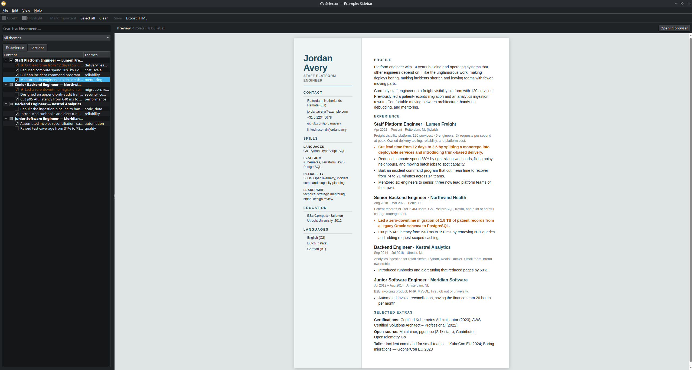

# CV Selector

A CV that lives in plain YAML files: one file per role, one manifest per job
application. Validate the dataset, pick the roles and bullets you want, render
a tailored HTML CV, print it to PDF.

No database, no lock-in. Every fact is a text file you can read, diff, and
edit by hand — or through the PySide6 desktop app, which writes the same files.



## Requirements

- Python 3.10 or newer
- No Node, Rust, or LaTeX toolchain
- The GUI needs PySide6, installed from `requirements.txt` (a few hundred MB
  with QtWebEngine). Its live preview uses QtWebEngine; on a minimal Linux
  install the app still runs and can open the preview in your browser (see
  Troubleshooting).

## Quick start

There are 3 python scripts that can be run on Linux/MacOS as well as Windows with the following command from the Terminal/Powershell:
```
python setup.py      #to run the automatic installation
python validate.py   #to render everything to out/cv.html
python launch_gui.py #to open the graphical user interface
```
Alternatively, the commands can also be run manually as follows:

Linux / macOS:

```sh
python3 -m venv .venv
.venv/bin/pip install -r requirements.txt

.venv/bin/python src/render.py --check    # validate the dataset
.venv/bin/python src/render.py            # render everything to out/cv.html
.venv/bin/python src/gui.py               # desktop app
```

Windows (PowerShell):

```powershell
python -m venv .venv
.venv\Scripts\pip install -r requirements.txt

.venv\Scripts\python src\render.py --check
.venv\Scripts\python src\render.py
.venv\Scripts\python src\gui.py
```

The repository ships empty, so the first render is a blank page. Fill in
`cv-data/profile.yaml`, add a role, and run it again.

To explore the ten bundled layouts instead, start the GUI and choose
`File → Load example…`, or see `examples/README.md` for the command-line
version.

## Layout

```
cv-data/                       the dataset — source of truth
  profile.yaml                 name, contact, summary paragraphs
  skills.yaml                  grouped skill categories
  education.yaml               degrees
  extras.yaml                  certifications, open source, talks, languages
  roles/<year>-<company>.yaml  one file per role, achievements nested inside
  roles/_TEMPLATE.yaml         copy this; files starting with "_" are ignored
  schema/*.schema.json         JSON Schema per file, enforced on every load
  applications/<slug>/         manifest + generated output per application
  notes/                       free-form Markdown, never parsed
src/cvlib.py                   loader, validator, selection, writer (no Qt)
src/render.py                  command-line renderer
src/gui.py                     PySide6 desktop app
templates/cv.html.j2           default single-column A4 template (Jinja2)
examples/                      10 bundled layouts with a shared fictional dataset
  data/                        sample profile, roles, skills, education, extras
  01-classic/ … 10-elegant/    example.yaml + template.html.j2 per layout
out/                           generated CVs (git-ignored)
```

## Dataset conventions

- **IDs are slugs.** Role IDs are unique across `roles/`; achievement IDs are
  unique within their role. Manifests reference these IDs.
- **Dates are quoted** `YYYY-MM`, and `null` means the current role.
- **One role per file** keeps diffs small and merge conflicts rare.
- **Bullets** read action → technology → measurable result.
- **Themes** are free-form tags (`performance`, `reliability`, `migration`,
  `mentoring`, `cost`, `security`). The GUI filters by them; a job-description
  match can use them later.
- **Colours** live in `profile.yaml` under `theme`. `accent` styles headings,
  rules, and links; `highlight` styles bullets marked `highlight: true`.
  Both are optional and fall back to the defaults.
- **Unknown fields are rejected.** If you add a field, add it to the matching
  schema file too.

## Dataset examples

### A profile

`cv-data/profile.yaml`:

```yaml
name: "Alex Beispiel"
headline: "Senior Software Engineer"
location: "Berlin, Germany · Remote (EU)"
email: "alex@example.com"
phone: "+49 30 1234567"

theme:                      # optional; these are the defaults
  accent: "#1f4e5f"         # headings, rules, links
  highlight: "#b45309"      # bullets marked as important

links:
  - label: "github.com/abeispiel"
    url: "https://github.com/abeispiel"
  - label: "linkedin.com/in/abeispiel"
    url: "https://linkedin.com/in/abeispiel"

summary:
  - >
    Senior software engineer with 9 years building and operating payment
    systems at scale. Deep in Go, PostgreSQL, and Kubernetes, with a track
    record of turning unreliable legacy services into observable ones.
  - >
    Comfortable owning a problem from design doc through on-call, and
    mentoring engineers into their next level.
```

Both paragraphs are optional. Keep one if that is enough; leave `summary` as an
empty list to omit the section entirely.

### A role

`cv-data/roles/2021-acme-senior.yaml`:

```yaml
id: acme-senior
company: Acme Payments
title: Senior Software Engineer
start: "2021-03"
end: null                    # null = current role
location: Remote (EU)
scope: >
  B2B payments platform, 40k daily active users, 1.2k req/s peak. Owned
  the billing domain on a team of six engineers.

achievements:
  - id: checkout-latency
    themes: [performance, delivery]
    text: >
      Cut p95 checkout latency from 900 ms to 180 ms by replacing N+1
      queries with batched reads, lifting checkout conversion 2.1%.
    metrics:
      - { label: p95 latency, before: 900, after: 180, unit: ms }

  - id: on-call-reliability
    themes: [reliability]
    text: >
      Raised availability from 99.5% to 99.95% and cut pages 60% by
      introducing SLOs, runbooks, and alert tuning.
    highlight: true          # optional; use the highlight colour
```

`metrics` is optional and currently informational — it keeps the numbers
structured so a future ranking step can use them.

### Skills, education, extras

```yaml
# cv-data/skills.yaml
categories:
  - name: Languages
    items: [Go, Python, TypeScript, SQL]
  - name: Reliability
    items: [SLOs, OpenTelemetry, Prometheus, incident command]
```

```yaml
# cv-data/education.yaml
entries:
  - degree: BSc Computer Science
    institution: Example University
    year: "2016"
```

```yaml
# cv-data/extras.yaml
certifications:
  - AWS Certified Solutions Architect – Associate (2024)
open_source:
  - Maintainer, example-queue (1.2k stars)
talks:
  - "Boring reliability: SLOs that engineers actually use — PyCon DE 2023"
languages:
  - English (C2)
  - German (B2)
```

### A selection manifest

Copy `cv-data/applications/_manifest.example.yaml` to
`cv-data/applications/2026-11-acme/manifest.yaml`:

```yaml
application:
  company: Acme Corp
  role_title: Senior Backend Engineer
  date: "2026-11-03"
  job_description: ""        # paste the posting; it records why this variant exists

include:
  roles:
    - id: acme-senior
      achievements: [checkout-latency, on-call-reliability]
    - id: globex-engineer    # bare id = every achievement in that role
  skills: [Languages]        # category names, in the order you want them
  education: false           # drop the section entirely
  extras: true
```

Rules:

- **Omit** `roles` or `skills` to include everything. An explicit empty list
  includes nothing, which is how the GUI represents "nothing selected".
- Roles render in the order you list them; without a manifest they sort
  newest-first by end date.
- Listing `achievements` selects and orders those bullets only.
- `education: false` / `extras: false` remove those sections.

## Commands

```sh
# validate only; prints counts, exits non-zero on any schema error
.venv/bin/python src/render.py --check

# full CV (all roles, all skills, education, extras)
.venv/bin/python src/render.py

# tailored CV from a manifest
.venv/bin/python src/render.py \
  --manifest cv-data/applications/2026-11-acme/manifest.yaml \
  --out out/acme.html
```

| Flag | Default | Meaning |
| --- | --- | --- |
| `--data` | `cv-data` | dataset directory |
| `--manifest` | none | selection manifest; omit for everything |
| `--template` | `templates/cv.html.j2` | Jinja2 template |
| `--out` | `out/cv.html` | output HTML file |
| `--check` | off | validate the dataset and exit |

`--check` validates the YAML dataset only. Manifest IDs are resolved when you
render, so a typo there surfaces as `unknown role id` at that point.

## Desktop app

```sh
.venv/bin/python src/gui.py
.venv/bin/python src/gui.py --data path/to/cv-data
```

The window is split in two: the experience library on the left, the live A4
preview on the right.

**Selecting** — tick roles or individual bullets. A ticked role includes all of
its bullets; unticking one leaves the role partially checked. The preview and
the `N role(s) · M bullet(s)` counter update immediately.

**Filtering** — type in the search box or pick a theme. Filters only narrow the
list; they never change what is selected.

**Colours** — the toolbar has two colour swatches:

- **Accent** — headings, rules, and links.
- **Highlight** — bullets you mark as important.

Select the bullets that deserve emphasis and press **Mark important**. If every
selected bullet is already highlighted, the button removes the highlight
instead, so it acts as a toggle for the selection. Highlighted bullets get a
star in the tree and render in the highlight colour. Colours are stored in
`profile.yaml` under `theme`; the flag is stored per achievement as
`highlight: true`, so both survive a restart and show up in the CLI render too.

**Sections** — unlike the search and theme filters, the checkboxes on the
Sections tab are part of the CV selection: skill categories, Education, and the
extras block (certifications, open source, talks, languages). They never delete
data; unchecking Education just omits the section from this variant and from a
manifest you save.

**Editing** — `Edit → Edit profile…` covers contact details, links, and summary
paragraphs. `Add role…` / `Edit role…` open a dialog with the role fields and
its achievement list; achievements can be added, removed, and reordered.
`Delete role…` removes the entry and its YAML file after confirmation.
`File → Open dataset…` switches to another `cv-data` folder.
`File → Load example…` opens one of the ten bundled layouts instead; see
[Bundled layouts](#bundled-layouts).

**Examples** — example mode loads the shared fictional dataset from
`examples/data`. It is read-only: selection, section checkboxes, preview, and
`Export HTML…` still work, but `Save`, `Save selection as…`, the colour
pickers, `Mark important`, and the editing actions are disabled. Use
`File → Open dataset…` to return to your own data and the default template.

**Saving** — dataset edits are not written until `Save` (`Ctrl+S`), including a
newly added role. Only changed files are written: the profile when colours or
contact details changed, and each edited role. Saves go through `ruamel.yaml`,
so comments and key order in untouched parts survive; comments inside a
replaced list (such as a role's achievements) may be dropped. Closing with
unsaved changes prompts you. Deleting a role is the exception: its file is
removed immediately after confirmation.

**Exporting** — `Export HTML…` (`Ctrl+E`) renders the current selection;
`File → Save selection as…` writes a manifest you can reuse with the CLI. The
manifest is written with a blank company, role title, and job description (only
the date is filled in) — edit those by hand if you want the record. `View →
Open preview in browser` renders to `out/preview.html` and opens it, which is
also the fallback when QtWebEngine is unavailable.

## Bundled layouts

`examples/` contains ten complete layouts that share one fictional dataset
(Jordan Avery, Staff Platform Engineer). Each directory has an `example.yaml`
with the display name and description, plus a standalone
`template.html.j2`. The dataset lives in `examples/data/`; its schema files are
copies of `cv-data/schema/` so the folder is self-contained.

| Directory | Name | Layout and style |
| --- | --- | --- |
| `01-classic` | Classic | Traditional single column, serif type, ruled headings. |
| `02-sidebar` | Sidebar | Light left rail for contact, skills, and education. |
| `03-timeline` | Timeline | Vertical timeline with dates in the margin and dot markers. |
| `04-compact` | Compact | Dense two-column one-pager with small type. |
| `05-editorial` | Editorial | Display type, pull-quote summary, numbered sections. |
| `06-minimal` | Minimal | Airy monochrome layout with hairline rules. |
| `07-header-band` | Header band | Full-width colour band and pill-shaped skills. |
| `08-cards` | Cards | A bordered card per role plus skill chips. |
| `09-technical` | Technical | Monospace labels and terminal-inspired section markers. |
| `10-elegant` | Elegant | Centred serif name, narrow right rail, dotted leaders. |

In the desktop app, choose `File → Load example…` and pick a layout. Example
mode is read-only so the bundled files cannot be changed by accident; export
still works. Render one from the command line with:

```sh
.venv/bin/python src/render.py \
  --data examples/data \
  --template examples/07-header-band/template.html.j2 \
  --out out/examples/header-band.html
```

`examples/README.md` lists the same layouts and explains the folder structure.

## Workflow

**Add a role**

1. In the GUI: `Edit → Add role…`, or copy
   `cv-data/roles/_TEMPLATE.yaml` to `cv-data/roles/2024-initech-engineer.yaml`.
2. Fill in the fields and achievements. Keep IDs stable once a manifest uses them.
3. `.venv/bin/python src/render.py --check`
4. `.venv/bin/python src/render.py`

**Tailor for an application**

1. In the GUI: tick the bullets, then `File → Save selection as…`. Or create
   `cv-data/applications/2026-11-acme/manifest.yaml` from the example by hand.
2. Paste the job description, list the roles and bullets that answer it.
3. Export to `out/acme.html` (choose the name in the export dialog).
4. Keep the manifest and the generated HTML together so the variant can be
   reproduced or compared later.

**Export to PDF**

Open the generated HTML in a browser → `Ctrl/Cmd + P` → *Save as PDF*, A4,
margins **Default**, **Background graphics on**. The filename convention
`Firstname_Lastname_CV.pdf` still applies.

## Troubleshooting

- `invalid YAML`: check indentation (spaces, never tabs) and quote strings
  that YAML would reinterpret: `"NO"`, `"on"`, `"1.10"`, dates, phone numbers.
- `does not match '^[a-z0-9]+...'`: IDs must be lowercase slugs.
- `unknown role id` / `unknown achievement id`: the manifest references an ID
  that does not exist in `roles/`. IDs are case-sensitive.
- `unknown skill categor(y/ies)`: use the exact `name` from `skills.yaml`.
- **The preview says QtWebEngine is missing.** The app still edits, saves, and
  exports; use `View → Open preview in browser`. On Fedora,
  `sudo dnf install krb5-libs` provides the missing library for live preview.
- **The app does not start with a "could not load the Qt platform plugin"
  error.** Install the XCB libraries for your distribution
  (`libxcb-cursor0` on Debian/Ubuntu, `xcb-util-cursor` on Fedora).
- Tinkering with a schema is fine — just keep it in sync with your files.

## Why files instead of a database

The dataset is meant to be reviewed in a pull request, grepped, and backed up
by copying a folder. At CV scale (hundreds of bullets) an in-memory list is
plenty; a database would add a binary blob that cannot be diffed.

If search ever gets slow, build a throwaway index at startup — never make it
the thing you edit.

## Roadmap

- Package the GUI with PyInstaller for Windows and Linux (build on each OS).
- Paste a job description and rank achievements by theme overlap.
- Export plain text for ATS fields and DOCX for portals that demand it.
- Optional SQLite FTS index built at startup, never edited directly.
